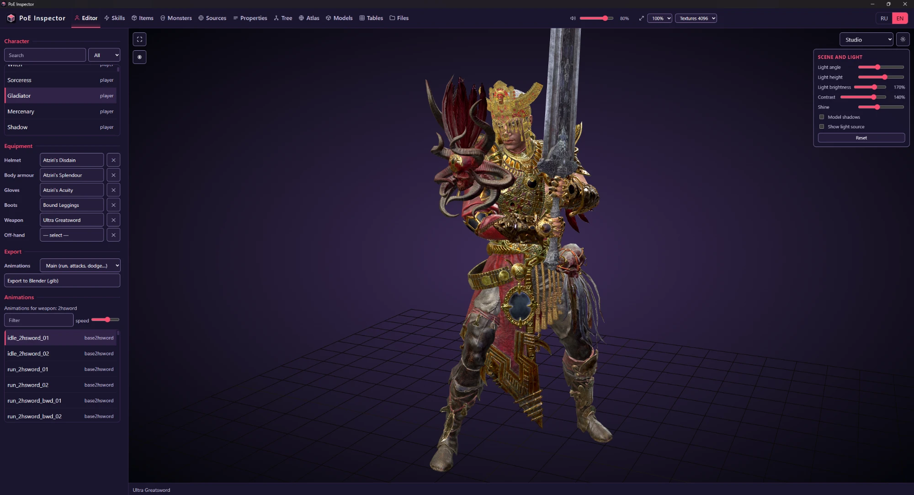

<div align="center">


# PoE Inspector

**A local database, 3D viewer and editor for the data of Path of Exile 2**

Everything is read straight from your own game install: skills, items, monsters, passive trees, mods, 3D models, animations, sounds and raw game tables, all in one desktop app.

🇬🇧 English · [🇷🇺 Русский](README.ru.md)

[⬇️ Download](https://github.com/COldVision/PoE-Inspector/releases/latest) · [✨ Features](#-features) · [🚀 Install](#-install) · [🛠️ Run from source](#%EF%B8%8F-run-from-source) · [❓ FAQ](#-faq)



</div>

---

## ✨ Features

| | Section | What it does |
|---|---|---|
| 🧙 | **Editor** | Dress a character and play animations |
| ⚡ | **Skills** | 1,400+ skills and gems with level scaling and live 3D previews |
| 🎒 | **Items** | 5,000+ base items and uniques with 3D models and item cards |
| 👹 | **Monsters** | 2,400+ monsters, bosses, their skills, animations and sounds |
| 🎯 | **Sources** | Where each unique item drops from |
| 📜 | **Properties** | Mod pools per base type with tiers and tags |
| 🌳 | **Tree** | The full passive tree with a build planner |
| 🌍 | **Atlas** | The Atlas passive tree |
| 🧊 | **Models** | Every 3D model in the game, exportable to `.glb` |
| 📊 | **Tables** | 1,000+ raw data tables with named columns |
| 🗂️ | **Files** | A browser over all 4.2 million game files |
| 🏠 | **Home** | Patch diff ("what's new in the client") and the official news feed |

Plus 🌐 a **RU / EN language switch** in the top right corner, 🔊 a shared volume control, 🖼️ texture quality and render scale controls, and 🔄 updates from GitHub Releases.

---

## 🧙 Editor

Pick a class or an NPC, put any helmet, body armour, gloves, boots, weapon or off-hand on it and watch it in 3D with the game's own textures.

- 🎭 Player class presets and 170+ NPC rigs
- 🛡️ Equipment slots with search over every base item
- 🏃 Animation list that follows the equipped weapon type (idle, run, attacks, dodge and more), with a speed slider
- 📦 **Export to Blender (`.glb`)** with the skeleton and the chosen animation set
- 💡 Scenes: Studio, In-game view, Empty (grid), with a light editor
- 🎬 Frame-exact recording of animations to transparent WebM or image sequences


## ⚡ Skills

Browse all active skills, supports, spirit gems, lineage gems and item skills grouped by weapon and gem level.

- 📈 Level slider with a damage-by-level chart and a full level table
- 📝 Skill description with stats, requirements, quality and tags
- 🎞️ The skill's animation played on the character in 3D
- 🔗 Compatible supports grouped by tag (Lineage, Fire, Cold, Chaos, Projectile, AoE and so on)
- 🔎 Filter by tag, category, or "with animation only"


## 🎒 Items

Every base item and unique in the game with its icon, 3D model and in-game style item card.

- 🔍 Search, category list, "Uniques", "DNT" (unused test items) and "with model only" filters
- 🧊 Orbit, zoom and light the model in the viewer
- 🧾 Item card with size, drop level, flavour text and requirements


## 👹 Monsters

Bosses and regular monsters, their 3D models and everything attached to them.

- 📊 Stat multipliers: life, damage, speed, experience, size, attack distance
- ⚔️ **Skills** (with the animations and sound events they use), **Animations**, **Audio** and **Files** tabs
- 🔊 Listen to voice lines and sound effects
- 📦 Export to Blender (`.glb`) with animations
- 🏷️ Filter by act and zone, "with model only", boss flag


## 🎯 Sources

A list of everything that drops unique items: bosses, trials, league content, vaults and more. Open a source to see which uniques come from it and how that is known (confirmed by the game's client tables or by Path of Building data).


## 📜 Properties

The mod pools of every item class, from daggers to jewels: base prefixes and suffixes plus the special pools (for example Genesis Tree minion and caster mods), each mod with its tags and tier range and the currencies that unlock it.


## 🌳 Tree

The complete passive tree rendered from the game's own data.

- 👤 Switch between all classes, with ascendancy points and the weapon-set counters (Shared / Set I / Set II)
- 🔎 Search passives by name or stat text
- 🧮 **Summary**, **Export**, **Import** and **Reset** for build planning
- 🔭 Smooth zoom and pan over thousands of nodes


## 🌍 Atlas

The Atlas passive tree with the same search, summary, export, import and reset tools.


## 🧊 Models

A direct search over all 58,000+ model files (`.smd`, `.fmt`) with textures and materials applied. Download any model as `.glb`, or jump to the source file.


## 📊 Tables

All 1,000+ `.datc64` data tables of the game, decoded. Column names come from the community dat-schema; if a schema is missing, columns are guessed. Paging and row filtering are built in.


## 🗂️ Files

A file browser over the whole `Bundles2` index (about 4.2 million files) with path search, previews for text, images and models, and download.


## 🏠 Home

Shows the indexed game folder and Steam build, and a **"What's new in the client"** diff: compare the current game data with any saved snapshot to see which skills, items, uniques, monsters, properties, models, tables and sounds were added or removed by a patch. Beside it runs the official Path of Exile news feed.


---

## 🚀 Install

1. ⬇️ Download **`PoE Inspector Setup 1.0.exe`** from the [latest release](https://github.com/COldVision/PoE-Inspector/releases/latest).
2. ▶️ Run it. No admin rights are needed; it installs into your user profile and includes its own Python, so nothing else has to be installed.
3. 🏁 On the first start the app finds your Path of Exile 2 folder and builds its database from your own game files (a few minutes, about 1 GB of disk space). Later starts are instant.

**Requirements:** Windows 10 or 11 (64-bit), Microsoft Edge WebView2 (preinstalled on current Windows), and Path of Exile 2 installed through Steam.

Your database and caches live in `%LOCALAPPDATA%\PoE Inspector` and are kept when you uninstall.

### 🔄 Updates

The app checks GitHub Releases at start. When a new version exists a banner offers **Download** (the package is verified by SHA-256) and then **Restart**. Updates replace code and web files only; a full installer is published when Python dependencies change.

---

## 🛠️ Run from source

```bash
pip install pillow numpy texture2ddecoder pywebview
python build_index.py      # once per game patch: index of all game files -> poe2.db
python run.py              # web UI at http://127.0.0.1:8765
python app_main.pyw        # or: the desktop window (WebView2) instead of a browser tab
```

Build the installer with Inno Setup 6:

```powershell
powershell -ExecutionPolicy Bypass -File installer\build_installer.ps1
```

Release steps are described in [`installer/RELEASE.md`](installer/RELEASE.md). The stack is a Python server (`poe_inspector/`) with a vanilla JS and three.js front end (`web/`); game bundles are read with Oodle through the `oo2core.dll` that ships with the game.

---

## ❓ FAQ

**Does it modify the game?** No. It only reads `Bundles2` from your install and never writes to the game folder.

**Does it contain game assets?** No. The repository and the installer hold no game data. Everything is built locally from the copy of the game you own.

**Why is the app so large after the first start?** The index of 4.2 million files and the derived tables take about 1 GB in `%LOCALAPPDATA%\PoE Inspector`.

**Can I switch the language?** Yes, with the RU / EN buttons in the top right. Game names follow the chosen language as well.

---

## ⚖️ Legal

PoE Inspector is an unofficial fan tool and is not affiliated with or endorsed by Grinding Gear Games. *Path of Exile* is a trademark of Grinding Gear Games. The project has no open-source licence; it is published for personal use, all rights reserved.
