<div align="center">


# PoE Inspector

**Локальная база данных, 3D-просмотрщик и редактор данных Path of Exile 2**

Всё читается прямо из вашей установленной игры: умения, предметы, монстры, деревья пассивок, свойства, 3D-модели, анимации, звуки и сырые таблицы игры в одном настольном приложении.

[🇬🇧 English](README.md) · 🇷🇺 Русский

[⬇️ Скачать](https://github.com/COldVision/PoE-Inspector/releases/latest) · [✨ Возможности](#-возможности) · [🚀 Установка](#-установка) · [🛠️ Запуск из исходников](#%EF%B8%8F-запуск-из-исходников) · [❓ Вопросы](#-вопросы-и-ответы)

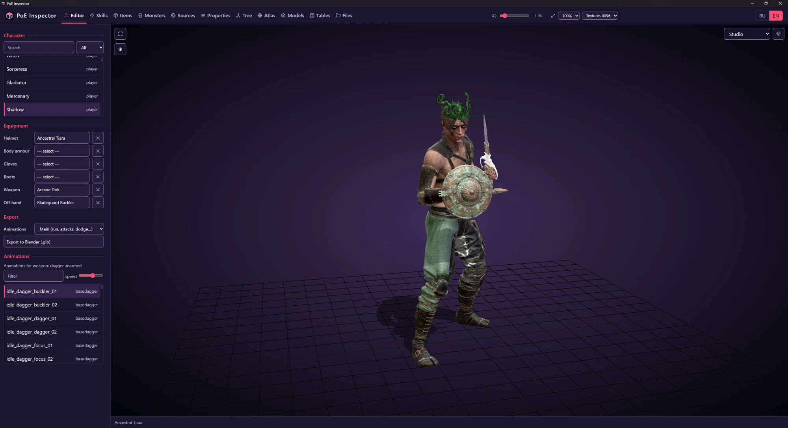

</div>

---

## ✨ Возможности

| | Раздел | Что делает |
|---|---|---|
| 🧙 | **Редактор** | Одевает персонажа и проигрывает анимации |
| ⚡ | **Умения** | Более 1400 умений и самоцветов с ростом по уровням и 3D-превью |
| 🎒 | **Предметы** | Более 5000 базовых предметов и уникальных, с 3D-моделями и карточками |
| 👹 | **Монстры** | Более 2400 монстров и боссов, их умения, анимации и звуки |
| 🎯 | **Источники** | Откуда падает каждый уникальный предмет |
| 📜 | **Свойства** | Пулы модификаторов по базам, с уровнями и тегами |
| 🌳 | **Дерево** | Полное дерево пассивных умений и планировщик билда |
| 🌍 | **Атлас** | Дерево пассивных умений Атласа |
| 🧊 | **Модели** | Все 3D-модели игры с экспортом в `.glb` |
| 📊 | **Таблицы** | Более 1000 сырых таблиц данных с именами колонок |
| 🗂️ | **Файлы** | Обозреватель всех 4,2 млн файлов игры |
| 🏠 | **Главная** | Сравнение патчей («Что нового в клиенте») и лента новостей |

Также: 🌐 **переключатель RU / EN** в правом верхнем углу, 🔊 общая громкость, 🖼️ качество текстур и масштаб отрисовки, 🔄 обновления через GitHub Releases.

---

## 🧙 Редактор

Выберите класс или NPC, наденьте любой шлем, броню, перчатки, ботинки, оружие или предмет для второй руки и смотрите результат в 3D с родными текстурами игры.

- 🎭 Пресеты классов игрока и более 170 NPC
- 🛡️ Слоты экипировки с поиском по всем базовым предметам
- 🏃 Список анимаций подстраивается под тип оружия (ожидание, бег, атаки, уклонение и другие), есть ползунок скорости
- 📦 **Экспорт в Blender (`.glb`)** со скелетом и выбранным набором анимаций
- 💡 Сцены: Студия, Игровой вид, Пустая сцена (сетка), редактор света
- 🎬 Покадровая запись анимаций в WebM с прозрачностью или в последовательность изображений


## ⚡ Умения

Все активные умения, поддержки, самоцветы духа, самоцветы наследия и умения предметов, сгруппированные по оружию и уровню самоцвета.

- 📈 Ползунок уровня с графиком урона по уровням и полной таблицей уровней
- 📝 Описание умения: параметры, требования, качество, теги
- 🎞️ Анимация умения на персонаже в 3D
- 🔗 Совместимые поддержки по тегам (Lineage, Fire, Cold, Chaos, Projectile, AoE и другие)
- 🔎 Фильтр по тегу, категории и «только с анимацией»

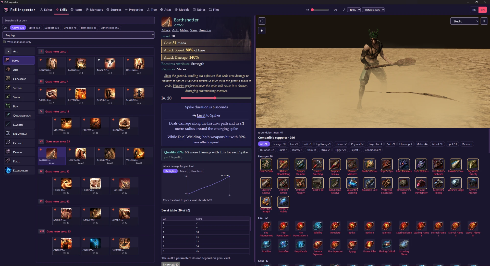

## 🎒 Предметы

Каждый базовый предмет и уникальный с иконкой, 3D-моделью и карточкой в стиле игры.

- 🔍 Поиск, список категорий, фильтры «Уникальные», «DNT» (неиспользуемые тестовые предметы) и «только с моделью»
- 🧊 Вращение, масштаб и освещение модели
- 🧾 Карточка: размер, уровень выпадения, flavour-текст, требования

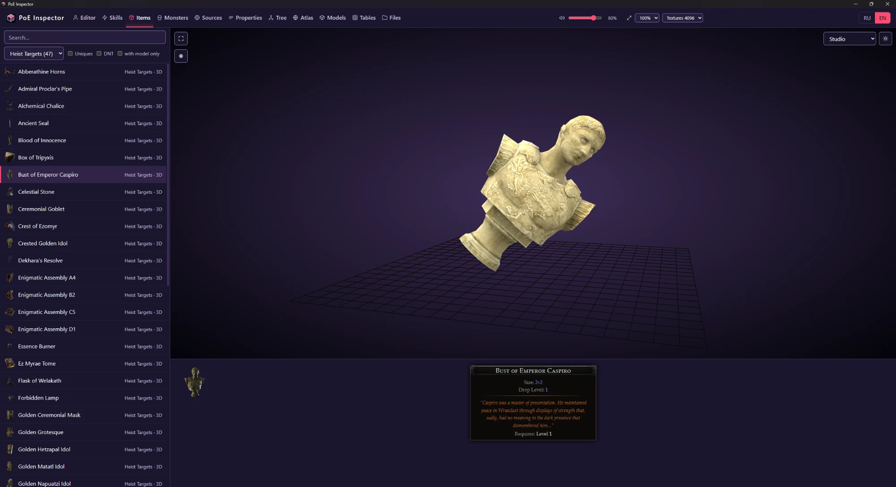

## 👹 Монстры

Боссы и обычные монстры, их 3D-модели и всё, что к ним привязано.

- 📊 Множители характеристик: здоровье, урон, скорость, опыт, размер, дистанция атаки
- ⚔️ Вкладки **Умения** (с используемыми анимациями и звуковыми событиями), **Анимации**, **Аудио** и **Файлы**
- 🔊 Прослушивание реплик и звуковых эффектов
- 📦 Экспорт в Blender (`.glb`) с анимациями
- 🏷️ Фильтры по акту и зоне, «только с моделью», пометка босса

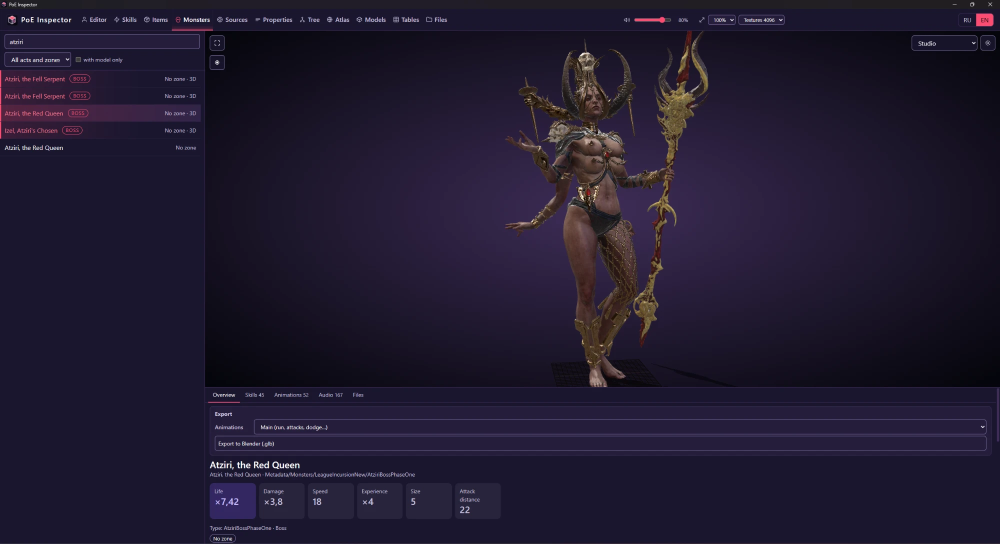

## 🎯 Источники

Список всего, из чего выпадают уникальные предметы: боссы, испытания, контент лиг, хранилища и другое. Откройте источник, чтобы увидеть его уникальные предметы и чем это подтверждено (таблицами клиента игры или данными Path of Building).

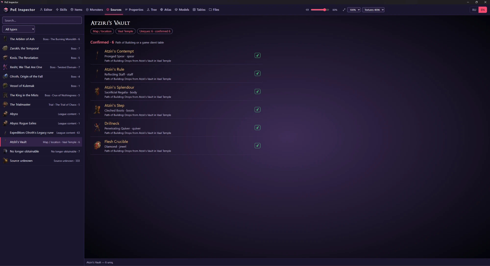

## 📜 Свойства

Пулы модификаторов каждого класса предметов, от кинжалов до самоцветов: базовые префиксы и суффиксы и особые пулы (например, модификаторы приспешников и заклинателей Древа Генезиса). У каждого модификатора есть теги, диапазон уровней и валюты, которыми он добавляется.

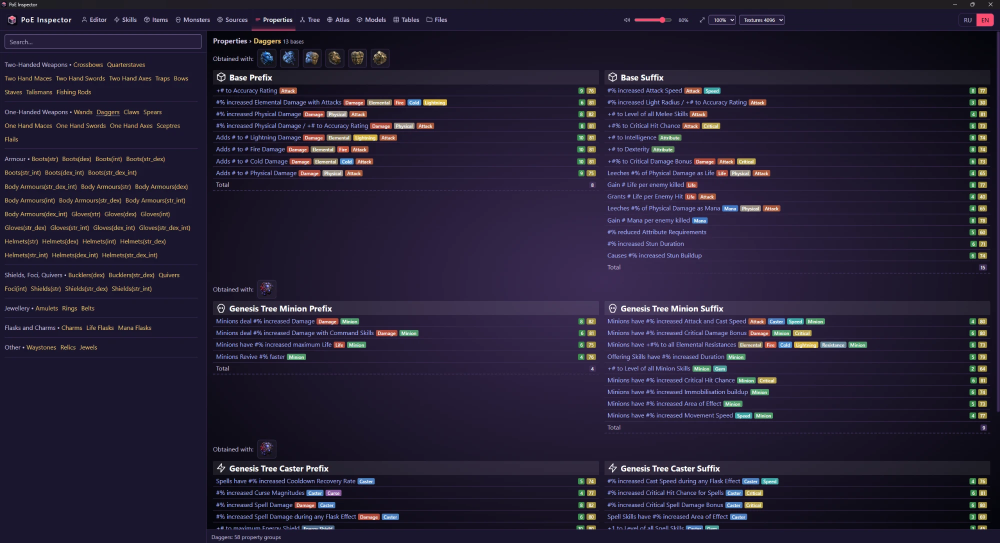

## 🌳 Дерево

Полное дерево пассивных умений, отрисованное по данным самой игры.

- 👤 Переключение между всеми классами, счётчики очков вознесения и наборов оружия (Общий / Набор I / Набор II)
- 🔎 Поиск пассивных умений по названию и тексту параметров
- 🧮 **Сводка**, **Экспорт**, **Импорт** и **Сброс** для планирования билда
- 🔭 Плавное масштабирование и перемещение по тысячам узлов

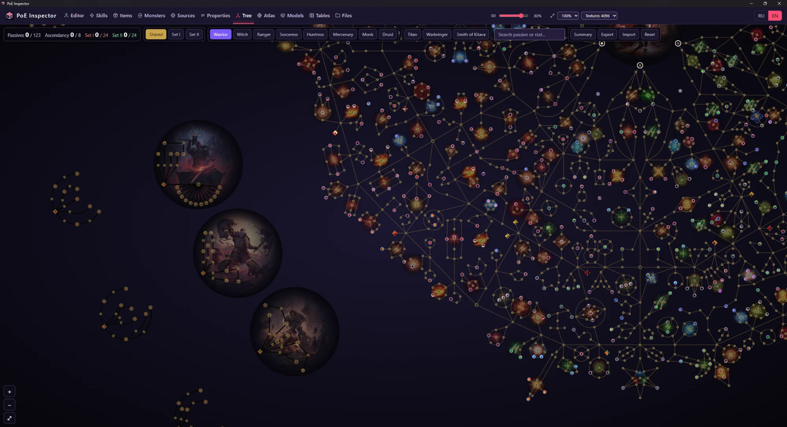

## 🌍 Атлас

Дерево пассивных умений Атласа с теми же инструментами поиска, сводки, экспорта, импорта и сброса.

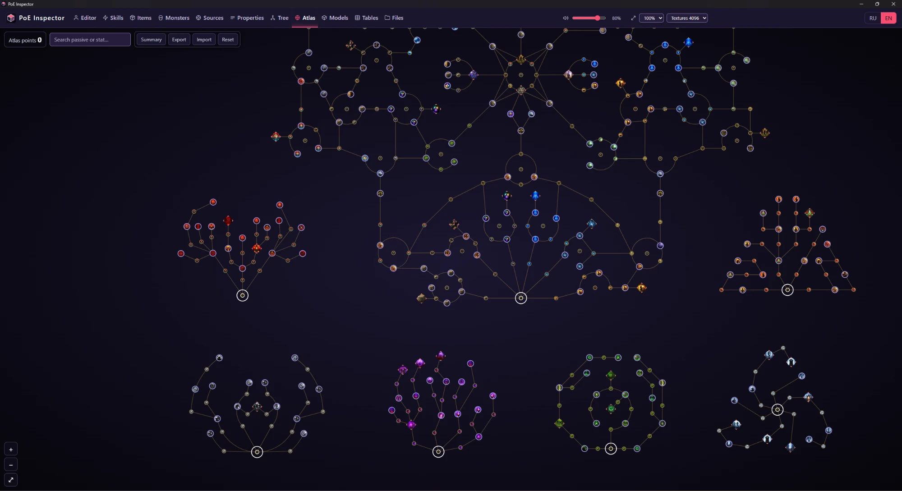

## 🧊 Модели

Прямой поиск по более чем 58 000 файлов моделей (`.smd`, `.fmt`) с наложенными текстурами и материалами. Любую модель можно скачать как `.glb` или открыть её исходный файл.

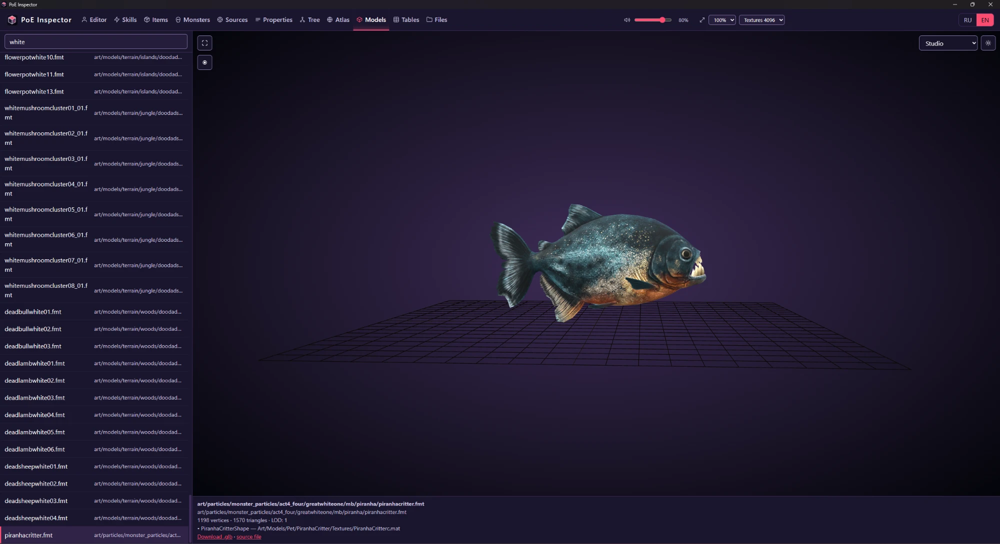

## 📊 Таблицы

Все более 1000 таблиц данных `.datc64` в расшифрованном виде. Имена колонок берутся из общедоступной dat-schema; если схемы нет, колонки угадываются. Есть постраничный просмотр и фильтр строк.

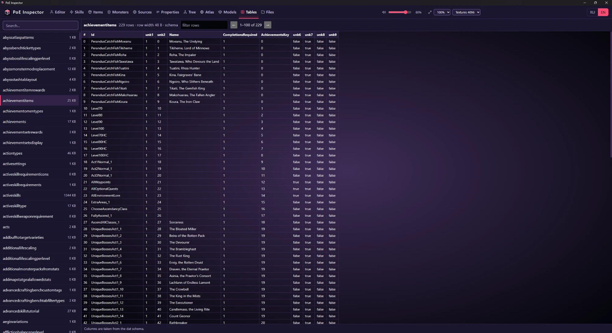

## 🗂️ Файлы

Обозреватель всего индекса `Bundles2` (около 4,2 млн файлов): поиск по пути, просмотр текста, изображений и моделей, скачивание.

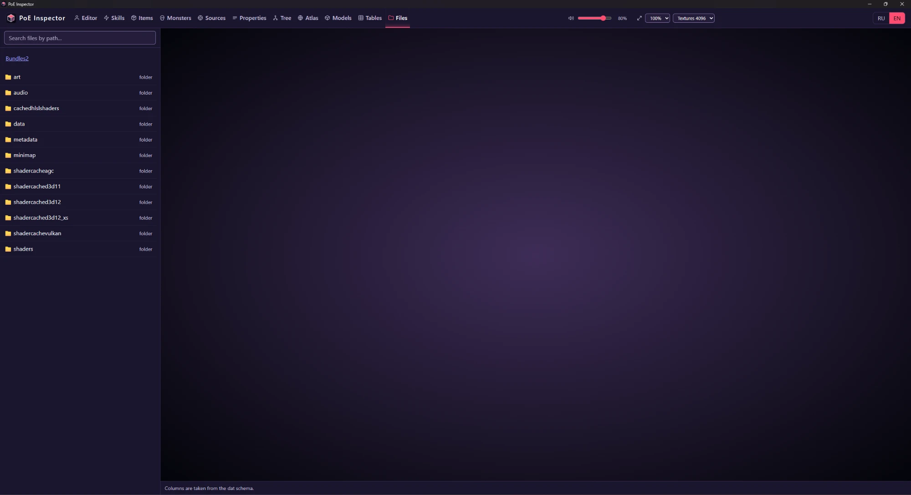

## 🏠 Главная

Показывает проиндексированную папку игры и сборку Steam, а также блок **«Что нового в клиенте»**: сравните текущие данные игры с любым сохранённым снимком и увидите, какие умения, предметы, уникальные, монстры, свойства, модели, таблицы и звуки добавил или убрал патч. Рядом идёт лента официальных новостей Path of Exile.

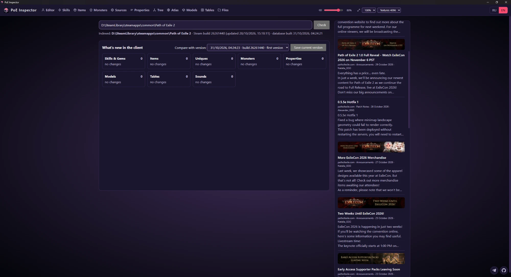

---

## 🚀 Установка

1. ⬇️ Скачайте **`PoE Inspector Setup 1.0.exe`** из [последнего релиза](https://github.com/COldVision/PoE-Inspector/releases/latest).
2. ▶️ Запустите. Права администратора не нужны: установка идёт в профиль пользователя, свой Python уже внутри, ничего ставить отдельно не требуется.
3. 🏁 При первом запуске приложение найдёт папку Path of Exile 2 и построит базу из ваших собственных файлов игры (несколько минут, около 1 ГБ на диске). Следующие запуски мгновенные.

**Требования:** Windows 10 или 11 (64-бит), Microsoft Edge WebView2 (в актуальной Windows уже есть), Path of Exile 2, установленная через Steam.

База и кэши лежат в `%LOCALAPPDATA%\PoE Inspector` и при удалении программы сохраняются.

### 🔄 Обновления

При запуске приложение проверяет GitHub Releases. Если вышла новая версия, появляется плашка с кнопкой **Скачать** (пакет проверяется по SHA-256), затем **Перезапустить**. Обновление заменяет только код и веб-файлы; полный установщик выпускается, когда меняются зависимости Python.

---

## 🛠️ Запуск из исходников

```bash
pip install pillow numpy texture2ddecoder pywebview
python build_index.py      # один раз после каждого патча игры: индекс всех файлов -> poe2.db
python run.py              # веб-интерфейс на http://127.0.0.1:8765
python app_main.pyw        # или окно приложения (WebView2) вместо вкладки браузера
```

Сборка установщика (нужен Inno Setup 6):

```powershell
powershell -ExecutionPolicy Bypass -File installer\build_installer.ps1
```

Порядок выпуска версии описан в [`installer/RELEASE.md`](installer/RELEASE.md). Устройство: сервер на Python (`poe_inspector/`) и интерфейс на чистом JS с three.js (`web/`); бандлы игры читаются через Oodle, библиотека `oo2core.dll` берётся из самой игры.

---

## ❓ Вопросы и ответы

**Программа меняет игру?** Нет. Она только читает `Bundles2` из вашей установки и ничего не пишет в папку игры.

**В репозитории есть ресурсы игры?** Нет. Ни в репозитории, ни в установщике нет данных игры. Всё строится локально из вашей копии игры.

**Почему после первого запуска столько места занято?** Индекс 4,2 млн файлов и производные таблицы занимают около 1 ГБ в `%LOCALAPPDATA%\PoE Inspector`.

**Можно переключить язык?** Да, кнопками RU / EN в правом верхнем углу. Названия из игры тоже меняются на выбранный язык.

---

## ⚖️ Правовая информация

PoE Inspector — неофициальный фанатский инструмент, не связанный с Grinding Gear Games и не одобренный ей. *Path of Exile* — торговая марка Grinding Gear Games. У проекта нет открытой лицензии: он опубликован для личного использования, все права защищены.
